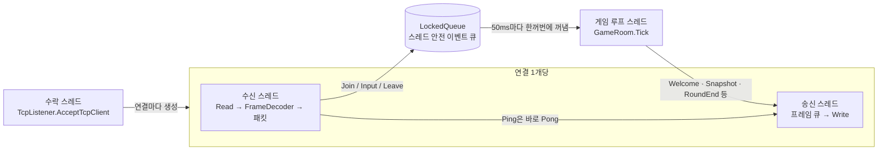

# 작업 기록: 핵심 게임 서버

- 담당 세션: `[OnlineSeverGame] 핵심 게임 서버 · 01`
- 상태: 핵심 완료. Unity 클라이언트 연동 확인됨(클라이언트 세션). 다듬기 단계.
- 관련 커밋: `4785969` (Shared 프로토콜), `edb56db` (서버·봇·테스트)
- 자세한 바이트 배치·상수 표: [`docs/protocol.md`](../protocol.md)

이 문서는 "무엇을 어떻게 만들었고, 실제로 어떻게 플레이되는지"를 사람이 읽기 위한 기록이다. 작업이 진행될 때마다 맨 아래 **변경 기록**에 한 줄씩 추가한다.

---

## 1. 게임이 어떻게 플레이되는가

### 한 판의 흐름

1. **대기(Waiting)**: 접속자가 2명(서버 옵션 `--min-players`)보다 적으면 대기한다. 그동안에도 자유롭게 뛰어다닐 수 있고 칼은 떨어지지 않는다.
2. **카운트다운(Countdown, 3초)**: 인원이 차면 모든 접속자가 참가자로 정해지고 스폰 지점 8곳으로 옮겨진다. 움직일 수는 있지만 칼은 아직 없다. 카운트다운 중에 들어온 사람도 이번 판에 참가한다.
3. **진행(Playing)**: 1초 뒤부터 칼이 떨어지기 시작한다.
   - 칼이 떨어질 자리에 먼저 **예고 표시**가 1초 동안 뜨고, 그다음 화면 위(높이 14)에서 초당 14유닛 속도로 떨어진다.
   - 칼은 처음 닿는 면에 꽂힌다. 발판 위에 떨어진 칼은 발판에 꽂히므로 **발판 아래는 안전지대**다.
   - 떨어지는 칼에 몸이 닿으면 즉사. 꽂힌 칼은 0.5초 뒤 사라지고 해가 없다.
   - 시간이 갈수록 빨라진다: 처음엔 1.5초마다 1개, 5초마다 간격이 조금씩 줄어 최소 0.2초 간격. 30초마다 한 번에 떨어지는 개수가 1개씩 늘어 최대 4개.
4. **결과(Ended, 5초)**: 한 명만 남으면 끝나고 순위가 나온다. 5초 뒤 인원이 충분하면 바로 다음 판 카운트다운, 아니면 대기로 돌아가 모두 부활한다.

### 조작 (Unity 클라이언트 기준)

| 키 | 동작 |
|---|---|
| ← → / A D | 좌우 이동 (가속 없이 바로 초당 8유닛) |
| ↑ / W / Space | 점프 (땅 위에서만, 최고 2.8유닛) |
| Shift / J | 대시 (바라보는 방향으로 0.2초간 4.8유닛, 공중에서도 가능, 1초 쿨다운) |
| ↓ / S | 누르고 있으면 발판을 통과해 아래로 떨어짐 |

### 방해: 대시 밀치기

- 대시 중에 다른 플레이어와 몸이 겹치면 상대가 대시 방향으로 튕겨 나가고(살짝 떠오름) **0.4초 동안 조작 불가**가 된다. 약 2.4유닛 밀린다.
- 부딪힌 쪽은 대시가 그 자리에서 끝난다.
- 둘이 동시에 대시하다 부딪히면 둘 다 반대 방향으로 튕긴다.
- 쓰임새: 발판 아래 안전지대에 숨은 사람을 칼 떨어지는 자리로 밀어내기.

### 스테이지 1 "Arena" (24 × 13.5 유닛)

```
 높이
 4.8            [=====가운데 발판=====]
 2.4  [==왼쪽 발판==]                [==오른쪽 발판==]
 0.0 ================================================  바닥
     0    3          9              15          21   24  (x, 유닛)
```

- 바닥에서 점프로 낮은 발판(2.4)에 오를 수 있다. 가운데 높은 발판(4.8)은 낮은 발판에서만 닿는다.
- 발판은 아래에서 위로 통과하고 위에서만 착지한다.
- 양 끝은 벽이라 밖으로 떨어지지 않는다.
- 칼을 정면으로 맞는 바닥은 양 벽 쪽(x 0~3, 21~24)뿐이다. 나머지 바닥은 위에 발판이 있어 지붕 역할을 한다. 대신 발판 위에 서 있으면 칼을 그대로 맞는다.

### 승패

- 최후의 1명이 승자.
- 마지막 남은 사람들이 **같은 순간에 모두 칼에 맞으면 전원 공동 우승**.
- 접속이 끊기면 그 순간 탈락이고 우승할 수 없다. 남은 사람이 모두 끊기면 승자 없음.
- 3분이 지나도 안 끝나면 그때 살아 있는 사람 전원 공동 우승.
- 순위는 늦게 죽은 순. 같은 순간 죽은 사람끼리는 같은 순위(1, 2, 2, 4 방식).
- 죽은 사람은 관전한다. 판 중간에 들어온 사람도 다음 판까지 관전한다.

---

## 2. 어떻게 구현했는가

### 전체 구조

```
Shared/   (서버·Unity가 같이 쓰는 코드, Unity 로컬 패키지)
  Protocol/    패킷 정의, 직렬화, 프레임 조립
  Simulation/  상수, 스테이지, 플레이어 물리, 칼, 대시 밀치기
Server/GameServer/        서버 콘솔 앱
Server/GameServer.Tests/  단위 테스트 (xUnit)
Tools/BotClient/          무작위 입력 봇
```

핵심 생각은 **"물리 한 스텝을 서버와 클라이언트가 똑같은 코드로 계산한다"**는 것이다. 그래야 클라이언트가 내 캐릭터를 미리 움직여 보여 주고(예측), 서버 결과가 오면 그 결과에서 아직 확인받지 못한 입력만 다시 계산해(재시뮬레이션) 어긋남 없이 맞출 수 있다.

### 좌표를 정수로 한 이유

좌표와 속도를 모두 **정수 밀리유닛**(1유닛 = 1000)으로 한다. 부동소수점은 .NET과 Unity(Mono/IL2CPP)에서 아주 작은 차이가 날 수 있는데, 정수는 어디서 계산해도 결과가 비트 단위로 같다. Unity는 그릴 때만 1000으로 나눈다.

### 서버 스레드 구성



- **수락 스레드** (`GameServer.AcceptLoop`): 접속을 받아 `Connection`을 만들고 그 연결의 스레드 2개를 띄운다.
- **수신 스레드** (`Connection.ReceiveLoop`): 소켓에서 블로킹으로 읽고, `FrameDecoder`로 프레임을 조립해 패킷으로 바꾼다. 첫 패킷은 반드시 Hello여야 하고 5초 안에 와야 한다. 이후 10초 동안 아무것도 안 오면 끊는다. 해석한 결과는 게임 상태를 건드리지 않고 이벤트로 바꿔 큐에 넣기만 한다. Ping만 게임 상태가 필요 없으므로 여기서 바로 Pong을 보낸다.
- **송신 스레드** (`Connection.SendLoop`): 보낼 프레임 큐를 비우며 소켓에 쓴다. 게임 루프가 느린 클라이언트 때문에 멈추지 않게 하려고 따로 뒀다. 큐가 256개를 넘으면(클라이언트가 안 읽음) 끊는다. `Monitor.Wait/Pulse`로 큐가 빌 때 잠든다.
- **이벤트 큐** (`LockedQueue`): 여러 수신 스레드가 락을 잡고 리스트에 추가한다. 게임 루프는 틱마다 리스트를 통째로 바꿔치기해서 가져가므로 락을 아주 잠깐만 잡는다.
- **게임 루프 스레드** (`GameServer.GameLoop` + `TickTimer`): 50ms 절대 시각표를 따라 돈다(n번째 틱 = 시작 + n × 50ms). 한 번 늦어도 다음 틱 목표 시각은 그대로라 지연이 쌓이지 않는다. 250ms 넘게 밀리면 따라잡기를 포기하고 현재 시각으로 맞춘다. 자세한 건 아래 "틱 타이머 정밀도".
- `GameRoom`과 "플레이어 id → 연결" 표는 게임 루프 스레드만 만진다. 그래서 게임 로직에는 락이 하나도 없다.
- 연결 종료는 `Connection.Close`가 한 번만 실행되게(Interlocked) 해서 Leave 이벤트가 정확히 한 번 간다.

### 프레이밍

TCP는 경계가 없는 바이트 흐름이라 "패킷 하나"가 여러 번에 나눠 오거나 여러 개가 한 번에 붙어 온다. 그래서 모든 패킷 앞에 2바이트 길이를 붙인다(`[u16 길이][타입][본문]`). `FrameDecoder`는 받은 바이트를 버퍼에 쌓고, 길이만큼 다 모였을 때만 패킷 하나를 꺼낸다. 길이가 0이거나 8192를 넘으면 잘못된 연결로 보고 끊는다.

### 한 틱(50ms)에 일어나는 일 (`GameRoom.Tick`)

1. 큐에 쌓인 네트워크 이벤트 반영: 입장, 입력 저장, 퇴장(라운드 중이면 즉시 탈락)
2. 살아 있는 플레이어마다 입력 하나를 꺼내 `PlayerPhysics.Step`으로 한 스텝 이동
3. `DashCollision.Resolve`로 대시 밀치기 판정
4. (진행 중이면) 칼 생성 → 칼 이동 → 칼에 닿은 사람 사망 → 끝났는지 검사
5. 카운트다운·결과 타이머 진행
6. 전원에게 스냅샷 전송 (플레이어 전체 상태 + 칼 목록)

### 입력과 시퀀스 번호

- 클라이언트는 매 틱 "지금 누르고 있는 버튼"과 1씩 오르는 번호(seq)를 보낸다.
- 서버는 플레이어마다 입력 큐를 두고 **한 틱에 하나씩만** 꺼내 쓴다. 꺼낸 번호를 스냅샷의 `lastInputSeq`로 돌려준다.
- 입력이 늦게 와서 큐가 비면 마지막 버튼을 한 번 더 쓴다. 점프·대시는 "이전 틱에는 안 눌렸다가 이번에 눌림"일 때만 발동하므로 반복돼도 두 번 뛰지 않는다.
- 큐가 8개 넘게 쌓이면(클라이언트가 너무 빨리 보냄) 오래된 것부터 버린다.

### 물리 한 스텝 (`PlayerPhysics.Step`)

이번 틱에 새로 눌린 버튼 계산 → 대시·쿨다운 타이머 감소 → (밀려나는 중이면 입력 무시하고 감속) → 이동 방향·대시 시작·점프 → 중력 → x 이동 후 벽 → y 이동 후 착지(지난 위치와 새 위치 사이에 있는 가장 높은 면). 숨은 상태가 없어서 같은 입력이면 항상 같은 결과가 나온다.

### 칼 판정

칼은 한 틱에 0.7유닛씩 떨어진다. 순간 위치만 보면 얇은 물체를 건너뛸 수 있으므로, 그 틱에 **지나간 영역 전체**(이전 위치 ~ 새 위치)를 상자로 만들어 플레이어 몸과 겹치는지 본다.

### 틱 타이머 정밀도 (`TickTimer`)

- 문제: Windows의 시스템 타이머는 기본적으로 약 15.6ms 간격으로만 깨어나서, `Thread.Sleep(10)`을 해도 최대 15ms쯤 늦게 깬다. 처음 버전은 틱이 최대 약 15ms씩 늦었다(누적되지는 않았지만 스냅샷 간격이 들쭉날쭉).
- 해결 1: 서버가 도는 동안 `timeBeginPeriod(1)`(winmm.dll)로 시스템 타이머 해상도를 1ms로 올린다. 서버가 끝나면 `timeEndPeriod(1)`로 되돌린다. 리눅스 등에서는 호출하지 않는다.
- 해결 2: 목표 시각 1.5ms 전까지는 `Thread.Sleep`으로 자고, 마지막 1.5ms는 `Thread.SpinWait`으로 짧게 돌며 기다린다. 대신 틱마다 CPU 한 코어를 1ms 남짓 쓴다.
- 30초마다 평균·최대 지연과 건너뛴 틱 수를 로그로 남긴다: `tick late avg 0.00 ms / max 0.18 ms, skipped 0`.

### 서버 로그

- 기본: 접속·퇴장, 라운드 시작·진행·종료, 사망, 순위, 30초마다 타이머 통계. 대시 밀치기는 하나하나 찍지 않고 라운드 종료 줄에 횟수만 붙인다(`winners: #7 'Bot7', pushes: 40`).
- `--verbose`: 밀치기를 `push #3 -> #5`처럼 하나씩 찍는다. 밀치기를 디버깅할 때만 쓴다(봇 8개면 한 판에 수십 줄).

### 봇의 칼 피하기 (`Tools/BotClient/DodgeBrain.cs`)

봇은 실제 클라이언트처럼 스냅샷만 보고 판단한다. 매 틱:

1. 예고(Warning)나 낙하(Falling) 중인 칼마다 "이 칼이 내 몸까지 내려오는가"를 본다. 칼이 내 머리 위 발판에 꽂힐 거면(`Stage.KnifeLandingY`) 무시한다. 발판이 지붕이 되기 때문이다.
2. 내려오는 칼은 "위험 구간"이 된다: 칼 x ± (칼 반폭 0.2 + 내 반폭 0.4 + 여유 0.3).
3. 내가 위험 구간 안에 있으면 어느 구간에도 걸리지 않는 가장 가까운 x로 걸어간다. 칼이 떨어지기 전에 걸어서 못 닿으면 대시한다. 칼이 내가 서 있는 발판에 꽂힐 거면 ↓를 눌러 발판 아래로 떨어진다. 그러면 발판이 지붕이 된다.
4. 안전하면 원래처럼 무작위로 돌아다니되, 3틱 안에 위험 구간에 들어갈 방향이면 멈춘다.
5. **반응 시간**: 봇마다 2~8틱(0.1~0.4초)을 무작위로 정해, 예고가 뜬 뒤 그만큼 지나야 알아챈다. 그래서 반응이 느린 봇은 여전히 맞고, 칼이 많아지는 후반에는 결국 다 죽는다.

`--ai random`을 주면 예전처럼 완전 무작위로 움직인다.

### 라운드 로직을 소켓과 분리한 이유

`GameRoom`은 소켓도 스레드도 모르는 순수 클래스다. 이벤트를 메서드로 넣고 `Tick()`을 부르면 보낼 패킷이 `Outbox`에 쌓인다. 덕분에 단위 테스트에서 서버를 띄우지 않고 "칼을 여기 떨어뜨리고 60틱 돌리면 누가 이기나"를 바로 검사할 수 있다.

---

## 3. 직접 돌려 보기

저장소 루트에서:

```bash
dotnet run --project Server/GameServer -- --port 7777 --min-players 2
```

```bash
dotnet run --project Tools/BotClient -- --count 8
```

- 봇 1개가 대표로 라운드 시작·사망·결과를 출력한다. 시작할 때 봇별 반응 시간(틱)도 찍는다.
- 봇은 기본으로 칼을 피한다(`--ai dodge`). 예전처럼 무작위로만 움직이게 하려면 `--ai random`.
- 서버에 `--verbose`를 주면 밀치기를 하나씩 로그로 찍는다.
- Unity 클라이언트와 함께 하려면 봇을 `--count 7`로 띄우고 클라이언트로 `127.0.0.1:7777`에 접속한다.
- 끊김 시험: 봇에 `--rounds 2 --drop-one-after 5`를 주면 첫 판 5초에 봇 하나가 강제로 끊긴다. 서버에 `--exit-after-rounds 2`를 주면 2판 뒤 스스로 종료한다.

서버 로그 예 (2026-10-27 실제 실행 발췌):

```
round 1 countdown, players: #1, #2, #3, #4, #5, #6, #7, #8
round 1 PLAYING with 8 players
death #1 'Bot4' by knife#1 at roundTick 56
leave #8 'Bot8' (Disconnected) (7/8) state=Playing
...
round 1 END after 530 ticks (26.5s) winners: #6 'Bot5'
    place 6: #8 survived 101 ticks (Disconnected)
round 2 countdown, players: #1, #2, #3, #4, #5, #6, #7
round 2 END after 821 ticks (41.1s) winners: #5 'Bot6'
```

---

## 4. 확인한 것과 남은 일

확인함 (2026-10-27):
- `dotnet build` 경고·오류 0, `dotnet test` 54개 통과.
- 서버 + 봇 8개: 1판 26.5초(승자 #6), 1판 도중 강제로 끊은 봇은 즉시 탈락으로 기록, 서버는 계속 돌아 7명으로 2판(41.1초, 승자 #5)까지 마치고 정상 종료. 대시 밀치기 45회.
- (첫 버전) 게임 루프는 틱마다 최대 약 15ms 늦었다(Windows 타이머 해상도). 다듬기 후 아래 참고.

다듬기 후 확인 (2026-10-27, 같은 시드 2026/7로 봇 8개 × 2판, 무작위 봇과 피하는 봇을 동시에 따로 실행):

| 항목 | 무작위 봇 (`--ai random`) | 피하는 봇 (`--ai dodge`) |
|---|---|---|
| 1판 길이 | 33.8초 | 101.5초 |
| 2판 길이 | 34.1초 | 100.4초 |
| 8위(가장 먼저 죽은 봇) | 2.5초, 4.2초 | 4.3초, 10.1초 |
| 틱 지연 최대 (30초 구간별) | 0.02~0.18ms | 0.04~0.10ms |
| 밀치기 | 40, 27회 (라운드 종료 줄에만) | 80, 48회 |

- 틱 지연: 최대 약 15ms → 0.2ms 이하. 건너뛴 틱 0.
- 피하는 봇은 판이 약 3배 길다. 반응이 느린 봇(7~8틱)은 여전히 초반에 죽고, 후반 칼 4개씩 0.2초 간격이 되면 모두 죽는다. 두 판 다 제한 시간(180초) 전에 끝났다.
- 밀치기 줄은 기본 로그에서 사라지고 라운드 종료 줄에 횟수만 남았다.
- `dotnet test` 62개 통과(봇 피하기 7개, 밀치기 로그 1개 추가).
- 확인 안 함: 스핀 대기로 늘어난 CPU 사용량은 재지 않았다.

클라이언트 세션이 확인 (2026-10-27, `a8cf1dc`·`92dd990`, 같은 PC, 자세한 내용은 [work/unity-client.md](unity-client.md)):
- 실제 Unity 클라이언트가 접속해 서버 + 봇과 여러 판 진행. 8인 방(봇 7 + 클라이언트) 한 판 끝까지.
- 클라이언트 2개끼리 대시 밀치기(서버 로그 `push #2 -> #1` 12회), 같은 칼에 둘이 동시에 죽어 공동 승리 표시.
- 카운트다운 중 입장 시 같은 번호 `RoundStart`가 다시 와서 참가자 목록이 갱신됨(2 → 5명).
- 내 캐릭터 예측은 걷기·점프·대시 중 어긋남 0회, 밀렸을 때만 보정.

아직 확인 안 함:
- 다른 PC 간 접속, 실제 네트워크 지연, 장시간 실행
- 사람이 키보드로 직접 하는 플레이 (클라이언트 확인은 자동 입력)

다듬을 후보:
- 서버 CPU 사용량 측정 (스핀 대기 비용)
- 봇이 다른 플레이어를 노려서 밀치기 (지금 밀치기는 우연히 부딪힐 때만)

---

## 변경 기록

- 2026-10-27 `4785969` Shared 프로토콜·물리·스테이지, `docs/protocol.md` 작성.
- 2026-10-27 `edb56db` 서버(스레드·방·라운드·칼·밀치기·관전·끊김 처리), 봇 클라이언트, 테스트 54개, CLAUDE.md 재작성, Python 로비 제거. 봇 8개로 2판 + 강제 끊김 확인.
- 2026-10-27 `fb8b8cf` 이 작업 기록 문서 작성 (사용자 요청: 작업마다 문서를 만들고 갱신).
- 2026-10-27 클라이언트 세션의 연동 확인 결과를 4장에 반영 (서버 코드 변경 없음).
- 2026-10-27 다듬기: 틱 타이머 정밀도(timeBeginPeriod + 마지막 1.5ms 스핀, 최대 지연 15ms → 0.2ms), 밀치기 로그를 라운드별 횟수로(`--verbose`로 개별 로그), 봇 칼 피하기(`DodgeBrain`, `--ai dodge|random`). 테스트 62개.
