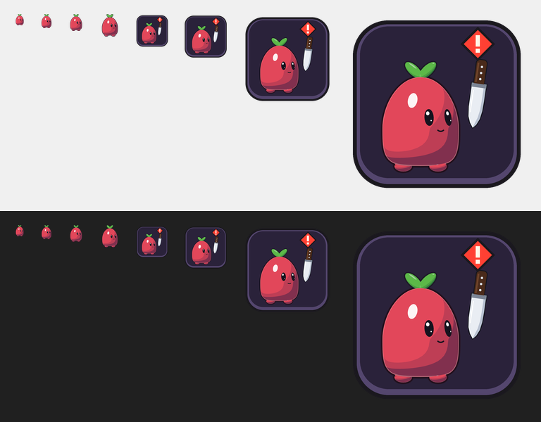
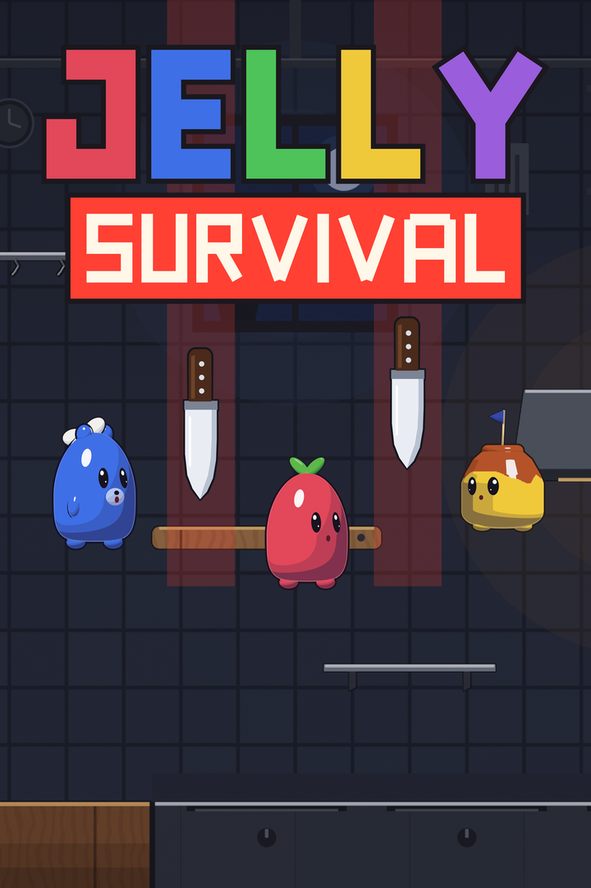
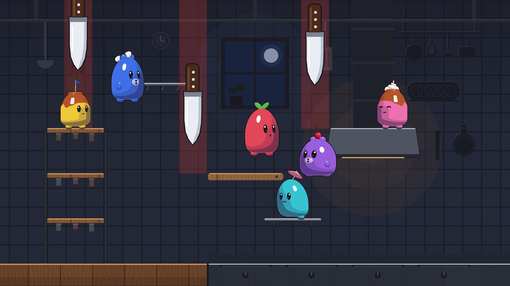

# 작업 기록: Microsoft Store 출시 준비

- 담당 세션: `[OnlineSeverGame] 스토어 출시 준비 · 01`, 브랜치 `claude/store-release-915848`(워크트리). main 병합은 사용자 승인 뒤 조율 세션이 한다.
- 목표: 사용자가 Partner Center 계정만 만들면 바로 제출할 수 있게 한다. 계정 만들기·이름 예약·업로드·제출은 사용자가 직접 한다(8장 순서대로).
- 상태: **준비 끝.** 게임 이름·버전·아이콘, MSIX 패키지 스크립트, 등록 글·스크린샷·로고, 연령 등급 답안, 개인정보 처리방침, 제출 안내서. 이 PC에서 패키지 설치 → 로컬 서버 7808 접속 두 판 → 제거까지 확인, 인증 키트(WACK) 결과 있음(9장).
- 근거: 2026-11-10에 Microsoft Learn 현재 문서를 직접 읽고 정했다. 주소는 12장.

---

## 1. 무엇이 바뀌었나 (플레이하는 사람에게)

| 항목 | 예전 | 지금 |
|---|---|---|
| 창 제목 · 시작 메뉴 이름 | OnlineSeverGame | **Jelly Survival** |
| 버전 | 1.0 | **1.0.0** (Store 패키지는 1.0.0.0) |
| 실행 파일·창 아이콘 | Unity 기본 아이콘 | **딸기 젤리 + 떨어지는 칼 + 빨간 예고** 아이콘(작은 크기는 젤리만) |
| 설치 | `Client.exe` 폴더 그대로 | 그대로 쓸 수 있고, Store용 MSIX 패키지가 따로 생김 |



### 저장 위치가 바뀐다 (한 번 초기화됨)

Unity는 저장값(PlayerPrefs)과 실행 기록(Player.log)의 위치를 `companyName`·`productName`으로 정한다. 이번에 둘 다 바꿨으므로:

| | 예전 | 지금(폴더째 실행) | Store 설치본(MSIX) |
|---|---|---|---|
| 저장값: 이름·서버 주소·언어·캐릭터·음량·흔들림 | `HKCU\Software\OnlineSeverGame\OnlineSeverGame` | `HKCU\Software\JellySurvivalDev\Jelly Survival` | 패키지 전용 레지스트리(실제 HKCU에 안 씀). **앱을 지우면 같이 지워짐** |
| 실행 기록 Player.log | `%USERPROFILE%\AppData\LocalLow\OnlineSeverGame\OnlineSeverGame\` | `%USERPROFILE%\AppData\LocalLow\JellySurvivalDev\Jelly Survival\` | 같은 곳(MSIX가 LocalLow는 따로 옮기지 않음, 확인함). 앱을 지워도 남음 |

- 그래서 새 빌드를 처음 켜면 **이름·서버 주소·언어·캐릭터·음량이 기본값으로 한 번 돌아간다.** 서버 주소는 공개 서버 `wildmagic.co.kr:7771`이 다시 나온다(예전 시험 때 저장된 `127.0.0.1:…`이 사라짐. `online-server.md` 4장에서 못 본 "처음 켜는 PC 화면"이 이것).
- 예전 저장값은 옮기지 않았다. 옛 위치에 그대로 남아 있고 새 빌드는 읽지 않는다.
- 다른 작업 문서(`gameplay-2.md`, `input-latency.md`, `ui-revamp.md`)에 적힌 Player.log 경로는 옛 경로다. 새 빌드에서는 위 표의 새 경로를 본다(남의 문서라 고치지 않음).
- `companyName` = `JellySurvivalDev`는 **임시 게시자 이름**이지만 저장 폴더 이름으로만 쓰인다. 계정을 만든 뒤에도 **바꾸지 않기를 권한다**(바꾸면 저장값이 또 초기화). Store에 보이는 게시자 이름은 MSIX 쪽 값(4장)이라 이것과 상관없다.

## 2. 어떻게 만들었나

| 파일 | 내용 |
|---|---|
| `Client/Assets/Editor/ProjectSetup.cs` | `ProductName`·`CompanyName`·`Version`·`IconPath` 상수와 `ApplyAppInfo()`(메뉴 `OnlineSeverGame/Apply App Info`). `BuildWindows()`가 빌드 전에 늘 부른다. 아이콘은 `PlayerSettings.SetIcons(NamedBuildTarget.Unknown, …)`로 기본 아이콘에 넣어 exe·창 아이콘이 된다 |
| `Client/ProjectSettings/ProjectSettings.asset` | 위 값이 저장된 결과(productName, companyName, bundleVersion 1.0.0, 아이콘) |
| `Client/Assets/Icon/AppIcon.png` | Unity 아이콘(1024, `make_art.py`가 복사) |
| `Tools/StorePackage/render_store_art.py` | Blender 스크립트. 게임 스프라이트와 **같은 모델**(`Art/blender/build_sprites.py`)을 6배 해상도(768 px/유닛)로 렌더: 젤리·젤리곰·푸딩 8색 × 대기·달리기·점프·낙하·대시·승리, 칼(`knife.blend` 8배). `Art/` 안의 파일은 건드리지 않고 `artifacts/store/render/`에 씀 |
| `Tools/StorePackage/make_art.py` | 앱 아이콘, Store 로고(포스터 2:3, 박스 1:1, 타일 300), 히어로 16:9, 타이틀 로고. 타이틀은 `UI/TitleLogo.cs`의 사각형 글자를 그대로 옮겨 그림(같은 좌표·색·외곽선). 배경은 게임 맵 그림 |
| `Tools/StorePackage/store_config.json` | **패키지 신원 값을 두는 유일한 곳**(앱 ID, 게시자, 게시자 표시 이름, 버전, 최소 Windows) |
| `Tools/StorePackage/AppxManifest.template.xml` | 매니페스트 틀 |
| `Tools/StorePackage/package_store.py` | Unity 빌드 → 레이아웃 → 타일 그림·`resources.pri` → `AppxManifest.xml` → `makeappx pack` |
| `Tools/StorePackage/test_cert.ps1` | 시험용 자체 서명 인증서 만들기·신뢰·지우기(이 PC 시험 전용, Store에는 필요 없음) |
| `Tools/StorePackage/take_screenshots.py` | 실제 게임 화면 촬영(로컬 서버 + 봇 7 + 빌드, 1920×1080) |

### 패키지(MSIX)를 이렇게 정한 이유

- **형식: MSIX.** Store가 권장하고, Store가 Microsoft 인증서로 다시 서명해 주므로 **유료 코드 서명 인증서가 필요 없다**. EXE·MSI로 내면 직접 Authenticode 서명해야 하고 설치 파일을 우리 서버에 올려 두어야 한다.
- **전체 신뢰 데스크톱 앱**: Unity 플레이어는 일반 Win32 프로그램이라 `uap10:RuntimeBehavior="packagedClassicApp"`, `uap10:TrustLevel="mediumIL"`(문서의 수동 패키징 틀 그대로).
- **기능(Capabilities)은 둘만**: `runFullTrust`(데스크톱 앱은 필수, 제한 기능이라 제출 때 이유를 적어야 함 → 8장 7단계), `internetClient`(게임 서버 접속. 전체 신뢰 앱에서는 막지 않지만 Store 목록에 "인터넷 연결 사용"을 정직하게 보이려고 넣음). 그 밖에 아무것도 없다.
- **최소 Windows**: `10.0.19043.0`(Windows 10 21H1). Unity 6 플레이어 요구 사항이 "Windows 10 version 21H1 (build 19043) or newer"이고, `uap10` 속성은 19041부터라 둘 중 높은 쪽. `MaxVersionTested`는 이 PC의 `10.0.26200.0`.
- **x64 하나**: Unity 빌드가 `StandaloneWindows64`. ARM PC는 Windows의 x64 에뮬레이션으로 돈다(직접 확인 못 함).
- **버전 1.0.0.0**: Store 규칙상 네 번째 자리는 0이어야 한다(Store 예약). 다음 업데이트는 `1.0.1.0`처럼 올린다.
- **언어**: 매니페스트 `en-us`, `ko-kr`(게임이 두 언어 지원). Store는 이 목록을 "지원 언어"로 보여 준다.
- **타일 그림**: Square44x44(작업 표시줄·시작 목록, 크기별 `targetsize-16…256`과 `altform-unplated`·`lightunplated`), Square150x150, Wide310x150, SmallTile 71, LargeTile 310, StoreLogo 50, 배율 100/125/150/200/400. 36 px 아래는 젤리만 그린 그림을 써서 16 px에서도 젤리로 읽힌다.
- **resources.pri**: `Assets/`만 색인(Unity 파일은 리소스가 아님). 하나짜리 패키지라 배율별로 쪼개지 않게 `priconfig.xml`의 `<packaging>`을 뺀다.
- 결과: `artifacts/store/JellySurvival_1.0.0.0_x64.msix` 약 81 MB(서명 없음, **이것을 업로드**).

## 3. 직접 돌려 보기

```bash
python -I Tools/StorePackage/make_art.py
```

```bash
python -I Tools/StorePackage/package_store.py --unity
```

- `make_art.py`: 처음 한 번 Blender로 캐릭터를 렌더(약 1분, Blender 5.2 경로는 환경 변수 `BLENDER`로 바꿀 수 있음)하고 아이콘·로고를 다시 만든다. 아이콘을 바꿨으면 Unity 빌드를 다시 해야 exe 아이콘에 들어간다.
- `package_store.py --unity`: Unity 배치 빌드(`ProjectSetup.BuildWindows`, 이름·버전·아이콘 적용 포함) 후 MSIX를 만든다. `--unity` 없이 돌리면 이미 있는 `Client/Build/Windows`로 묶는다. Windows SDK의 `makeappx.exe`·`makepri.exe`가 필요하다(이 PC: `C:\Program Files (x86)\Windows Kits\10\bin\10.0.26100.0\x64\`).

### 이 PC에서 설치해 보기(선택)

Store에 올리는 패키지는 서명이 없어서 그대로는 설치되지 않는다. 시험 방법 둘:

1. **서명 없는 시험 패키지(이번에 쓴 방법)**: Windows 11은 게시자에 특수 OID를 붙인 패키지를 인증서 없이 설치할 수 있다. 관리자 PowerShell에서:

```bash
python -I Tools/StorePackage/package_store.py --unsigned-test
```

```powershell
Add-AppxPackage -Path artifacts\store\JellySurvival_1.0.0.0_x64_unsignedtest.msix -AllowUnsigned
```

   이 시험본은 게시자 값이 `CN=JellySurvivalDev, OID.2.25.311729368913984317654407730594956997722=1`이라 Store본과 신원이 다르다(일부러 그렇게 되어 있음). 모든 사용자에게 설치된다.

2. **자체 서명 인증서**: `--sign-test`로 `…_testsigned.msix`를 만들고, 관리자 권한으로 `test_cert.ps1 -Action Trust`를 돌려 인증서를 `LocalMachine\TrustedPeople`에 넣은 뒤 `Add-AppxPackage`. 인증서 신뢰 저장소를 바꾸는 일이라 이번 세션에서는 자동 권한 검사에 막혀 하지 않았다(9장).

인자를 넣어 실행(로컬 서버에 붙이기):

```powershell
$p = Get-AppxPackage -Name JellySurvivalDev.JellySurvival; Invoke-CommandInDesktopPackage -PackageFamilyName $p.PackageFamilyName -AppId JellySurvival -Command (Join-Path $p.InstallLocation 'Client.exe') -Args "-server 127.0.0.1:7808 -autoconnect"
```

지우기:

```powershell
Get-AppxPackage -Name JellySurvivalDev.JellySurvival | Remove-AppxPackage -AllUsers
```

## 4. 계정을 만든 뒤 바꿀 값 (한 곳)

Partner Center > 앱 > **Product management > Product identity** 페이지에 세 값이 나온다. `Tools/StorePackage/store_config.json`에서 이 셋만 바꾸고 `package_store.py`를 다시 돌린다. **대소문자·공백·점까지 똑같이** 붙여 넣는다(문서: 값은 대소문자를 구분하고 공백·문장부호도 일치해야 함).

| store_config.json 키 | 지금(임시) | Partner Center 칸 | 예시 모양 |
|---|---|---|---|
| `identityName` | `JellySurvivalDev.JellySurvival` | Package/Identity/Name | `12345YourName.JellySurvival` |
| `publisher` | `CN=JellySurvivalDev` | Package/Identity/Publisher | `CN=1A2B3C4D-5E6F-…` |
| `publisherDisplayName` | `JellySurvivalDev` | Package/Properties/PublisherDisplayName | 계정의 게시자 표시 이름 |

- `displayName`(`Jelly Survival`)은 예약한 앱 이름과 같아야 한다. 이름 예약이 다르게 되면(예: `Jelly Survival!`) 이것도 바꾼다.
- 바꾼 뒤 `--unsigned-test`/`--sign-test` 시험본도 새 값으로 다시 만들어진다(시험 인증서의 주체는 `publisher` 값을 따라감).
- Unity `companyName`은 바꾸지 않는다(1장).

## 5. 등록 자료 (`Art/store/`)

| 파일 | 쓰는 곳(Partner Center) | 규격(문서) |
|---|---|---|
| `Art/store/listing.md` | Store listings: 설명·짧은 설명·제품 기능·키워드·스크린샷 설명·저작권·추가 시스템 요구 사항, 한국어·영어 | 설명 ≤ 10,000자, 짧은 설명 ≤ 1,000자(270자 권장), 기능 ≤ 20개 × 200자, 키워드 7개 × 40자·21단어, 스크린샷 설명 ≤ 200자 |
| `Art/store/screenshots/ko/*.png`, `en/*.png` | Screenshots(Desktop), 언어별로 따로 올림 | PNG, 1366×768 이상(4K까지), 1장 필수·최대 10장, 50 MB 이하. 핵심은 위쪽 2/3 |
| `Art/store/logos/poster_2x3_720x1080.png` (또는 `_1440x2160`) | Store logos > 2:3 Poster art | 게임은 **강력 권장**(메인 로고로 쓰임), 제목은 위쪽 2/3 |
| `Art/store/logos/boxart_1x1_1080.png` (또는 `_2160`) | Store logos > 1:1 Box art | 1080×1080 또는 2160×2160 |
| `Art/store/logos/tile_1x1_300.png` | Store logos > 1:1 App tile icon | 300×300, 올리면 패키지 아이콘보다 우선 |
| `Art/store/logos/hero_16x9_1920x1080.png` (또는 `_3840x2160`) | Windows 10/11 and Xbox image > 16:9 Super hero art | **글자 없이**, 1920×1080 또는 3840×2160. 아래 1/3에 중요한 것 두지 않기 |
| `Art/store/privacy/privacy-policy.html` | wildmagic.co.kr에 올리고 그 주소를 Properties > Privacy policy URL | 6장 |
| `Art/store/icon/app_icon_1024.png` | 원본 아이콘(패키지 타일·Unity 아이콘의 원본) | |
| `Art/store/logos/title_logo_1600.png` | 타이틀 로고만(투명), 웹페이지 등에 | |





- 로고 그림은 실제 게임 모델·맵 그림·타이틀 그대로다(콘셉트 그림이나 다른 게임 이미지 없음 → 정책 10.1 "실제 기능을 정확히 보여 줄 것"). 포스터·박스 아트 제목은 위쪽 2/3 안, 히어로는 글자 없음.
- 스크린샷은 실제 빌드를 로컬 서버(맵 고정) + 봇 7명과 돌려 찍었다(`take_screenshots.py`). 원본은 `artifacts/store/shots/<언어>/`, 고른 것만 `Art/store/screenshots/<언어>/`에 번호를 붙여 넣었다. 화면 위 글은 그 언어 그대로이므로 한국어 등록에는 `ko`, 영어 등록에는 `en`을 올린다. 다른 플레이어 이름은 봇 이름(Mochi1 등)이다.
- 저작권 칸의 `[게시자 이름]`은 계정 게시자 이름으로 바꿔 넣는다.
- 묶음: `package_store.py`가 돌 때마다 `Art/store/` 전체를 `artifacts/store/listing/`에 복사하고 `artifacts/store/JellySurvival_store_listing.zip`(약 26 MB)으로 묶는다. `artifacts/`는 Git에 올리지 않으므로 원본은 `Art/store/`다.
- 고른 장면: 01 접속(캐릭터 고르기, 기본 서버 주소 `wildmagic.co.kr:7771`이 보임), 02 대기(접속자 카드·방장 맵 고르기), 03 주방, 04 겨울 처마(20초 옆 위험물 예고 띠), 05 창고(컨베이어 이벤트 예고), 06 디저트 가게(마카롱 예고 띠), 07 결과 단상. 내 젤리가 살아 있는 장면을 골랐다(관전 띠 없음). 영어 접속 화면은 한국어 촬영이 저장한 시험 주소가 보여서 `-server wildmagic.co.kr:7771`(접속하지 않음)로 한 번 더 찍었다(`artifacts/store/shots/en2/`).

### 글에서 지킨 것

- 정책 10.1.1(중요한 제약을 설명할 것): **온라인 전용·인터넷 필요·혼자 모드 없음·키보드 필요·게임패드 없음**을 설명 끝 "알아 두세요"와 추가 시스템 요구 사항에 적었다.
- 정책 10.1.1(제목에 홍보 문구 금지): 제품 이름은 `Jelly Survival` 그대로.
- 정책 10.1.3(키워드 7개 이하, 관련된 말, 가격 말·다른 제품 이름 금지)에 맞췄다.
- 설명 칸에 URL·HTML 없음.

## 6. 개인정보 처리방침 (`Art/store/privacy/privacy-policy.html`)

한 장에 한국어·영어. 사용자가 wildmagic.co.kr에 올린다. **올리기 전에 노란 칸 두 곳(게시자 이름, 연락 이메일)을 채운다.**

왜 필요한가: 정책 10.5.1 — 개인정보를 접근·수집·전송하면 처리방침이 있어야 하고, **Win32·Desktop Bridge 앱은 늘 있어야 한다**("Product types that inherently have access to Personal Information must always have privacy policies. These include … Desktop Bridge and Win32 products"). 이 게임은 둘 다 해당.

적은 내용은 코드에서 확인한 사실이다(2026-11-10, 프로토콜 v12):

| 사실 | 근거 |
|---|---|
| 서버로 보내는 것: 이름(≤ 32바이트), 캐릭터, 입력, 핑, 방장 맵 선택, 이모트, 그리고 접속에 따른 IP·포트 | `Shared/Protocol`, `ProtocolConstants.MaxNameBytes = 32` |
| 다른 플레이어에게 보이는 것: 이름·캐릭터·색·움직임·이모트·순위. IP는 보내지 않음 | 패킷 정의(다른 사람 정보는 번호·이름·캐릭터·상태만) |
| 서버는 DB·계정 없음, 접속 중 메모리만 | `GameRoom`, `GameServer` |
| 서버 로그: `conn N accepted from <IP:포트>`, `join #N '<이름>'`, leave, death | `GameServer.cs:101`, `GameRoom.cs:246, 260, 616` |
| 로그 파일: 맥·리눅스 설치 패키지의 `start.sh`가 `logs/server.log`에 계속 붙여 씀(자동 삭제 없음). 윈도우 `run-server.bat`은 창에만 출력 | `Tools/ServerPackage/package_server.py` |
| PC에 저장: PlayerPrefs `name`, `server`, `lang`, `character`, `lastColor`, `vol_bgm`, `vol_sfx`, `juice_shake` | 클라이언트 코드 |
| Unity 분석·오류 보고·광고·결제 꺼짐 | `Client/ProjectSettings/UnityConnectSettings.asset` |
| 통신 암호화 없음(평문 TCP) | `Net/NetClient.cs`, 서버 소켓 |

**사용자가 지켜야 할 약속**: 처리방침에 "로그는 30일이 지나면 지운다"고 적었다. 지금 서버는 로그를 지우지 않으므로, 맥미니에서 한 달에 한 번 `logs/server.log`를 지우거나(서버를 잠깐 멈추고) 다른 기간을 원하면 HTML 문구를 고친다.

## 7. 연령 등급(IARC) 설문 답안 초안

Partner Center > 제출 > **Age ratings**에서 처음 한 번 IARC 설문을 한다(게시자 표시 이름과 이메일이 IARC에 전달됨). 질문 문구는 IARC가 바꿀 수 있으니 아래는 "이 게임의 사실"을 질문 주제별로 정리한 것이다. 질문마다 옆의 i 아이콘 설명을 읽고 이 사실에 맞는 쪽을 고른다.

| 주제 | 이 게임의 사실 | 답 |
|---|---|---|
| 분류 | 게임(Game) | Game |
| 폭력 | 귀여운 젤리 캐릭터가 위에서 떨어지는 식칼·고드름·상자·포크, 옆에서 날아오는 칼·눈덩이·상자·마카롱에 닿으면 탈락. 탈락 동작은 눈이 X가 되고 납작해지는 만화 표현. **피·상처·잘림 없음**. 사람·동물 아님(젤리·젤리곰·푸딩). 플레이어끼리 대시로 밀치고 머리를 밟으면 잠깐 기절(만화식 별). 무기를 플레이어가 쓰지는 않음 | 만화·판타지 폭력(cartoon/fantasy violence) 있음, 사실적 폭력·피 없음 |
| 공포 | 무서운 장면·소리 없음 | 없음 |
| 성적 내용·노출 | 없음 | 없음 |
| 욕설·저속한 말 | 게임 글에 없음. 이모트 "놀리기"는 몸짓뿐 | 없음 |
| 약물·술·담배 | 없음 | 없음 |
| 도박·모의 도박 | 없음 | 없음 |
| 차별·혐오 | 없음 | 없음 |
| 사용자끼리 상호작용 | 온라인으로 최대 8명이 같은 판. **플레이어가 정한 이름이 다른 사람에게 보임**, 이모트 4종(정해진 동작). **채팅·음성·글 주고받기 없음**, 친구·메시지 없음 | 사용자 상호작용 있음(Users Interact) — 이름 표시 때문 |
| 개인정보 공유 | 이름 외에 다른 플레이어에게 가는 개인정보 없음, 위치 공유 없음 | 없음 |
| 디지털 구매 | 없음(무료, 앱 안 구매 없음) | 없음 |
| 제한 없는 인터넷 접근(브라우저 등) | 없음 | 없음 |

예상: 매우 낮은 등급(3+~7+ 대)에 "사용자 상호작용" 표시가 붙을 가능성이 크다. 실제 등급은 IARC가 정하므로 결과를 보고 받아들이면 된다.

## 8. 제출 안내서 (사용자가 직접 할 일, 순서대로)

**0. 미리 준비**
- 공개 서버(맥미니)를 **이 패키지와 같은 프로토콜 버전(v12)**으로 켜 둔다: `python -I Tools/ServerPackage/package_server.py`로 만든 `JellySurvivalServer-v12-…` 패키지. 포트 7771이 밖에서 열려 있는지 다른 네트워크에서 `Test-NetConnection wildmagic.co.kr -Port 7771` → `TcpTestSucceeded : True`. (2026-11-10 현재 닫혀 있음, `online-server.md` 4장.)
- **심사 동안 혼자서도 판이 열리게** 서버 설정 `server.conf`의 `MIN_PLAYERS=1`을 권한다. 기본 2면 심사원이 혼자 들어가 "다른 플레이어를 기다리는 중"에서 멈추고, 게임을 시험할 수 없어 정책 10.3(시험 가능해야 함)으로 떨어질 수 있다. 1이면 혼자서도 바로 판이 시작되고, 맞으면 판이 끝난다(코드 확인: 혼자 판은 그 사람이 탈락할 때 끝남).
- 처리방침 HTML의 노란 칸을 채워 wildmagic.co.kr에 올리고 주소를 확인한다(예: `https://wildmagic.co.kr/jelly-survival/privacy.html`).

**1. 개발자 계정 만들기(무료)**
- `https://storedeveloper.microsoft.com` → **Get started for free** → **Individual developer**(개인) → Microsoft 계정으로 로그인 → 신분증과 셀카로 신원 확인(휴대폰으로 찍음) → 정보 확인 → **Go to Partner Center dashboard**. 개인 계정은 등록비가 없다. 회사 계정이 필요한 경우(사업자 이름으로 낼 때)가 아니면 개인으로 한다(정책 10.14). **개인 → 회사 전환은 안 되니** 처음에 정한다.
- 게시자 표시 이름은 Store에 보이는 이름이다. 회사처럼 보이는 이름이면 회사 계정을 요구받을 수 있다(10.14).

**2. 앱 이름 예약**
- Partner Center > Apps and games > **New product > MSIX or PWA app** → 이름 `Jelly Survival` 입력 → **Check availability** → **Reserve product name**. 이미 쓰였으면 다른 이름을 예약하고 4장 `displayName`도 그 이름으로 바꾼다.

**3. 패키지 값 바꾸고 다시 묶기**
- 앱 > **Product management > Product identity**의 세 값을 `store_config.json`에 넣는다(4장).
- 저장소 루트에서 `python -I Tools/StorePackage/package_store.py --unity` → `artifacts/store/JellySurvival_1.0.0.0_x64.msix`.

**4. 제출 만들기**: 앱 개요 > **Start submission**. 아래 칸들을 채운다(순서는 자유).

**5. Pricing and availability**
- Markets: 기본(모든 시장) 또는 원하는 나라. Base price: **Free**. 나머지 기본값.

**6. Properties**
- Category: **Games**, 장르(최대 3): **Platformer**, **Action + adventure**(또는 Family + kids). 이 게임은 2D에서 걷고 뛰는 게임이라 문서의 Platformer 설명("2-dimensional where player can control character's walk, jump")과 맞는다.
- Privacy policy: "개인정보를 접근·수집·전송한다" **예** → URL 입력(0단계 주소).
- Website(선택): wildmagic.co.kr. Support contact info(선택, Xbox에 낼 때만 필수).
- Game settings: **Online multiplayer** 체크, 최소 2(서버를 1로 두면 1)·최대 **8**. Cross-platform 아님.
- System requirements: Minimum hardware에 **Keyboard**, **Internet** 해당 항목 체크(있으면). Display mode는 비워 둔다.

**7. Age ratings**: 7장 답안대로 설문 → **Save and generate**.

**8. Packages**: `JellySurvival_1.0.0.0_x64.msix`를 끌어 놓는다 → 검증 통과 확인. Device family는 **Windows 10/11 Desktop**만(Xbox·HoloLens 끔).

**9. Store listings**: 언어 추가에서 **한국어**와 **English (United States)**. 언어마다 `Art/store/listing.md`의 해당 칸을 붙여 넣고, 스크린샷(그 언어 폴더), 로고(포스터·박스·타일), 히어로를 올린다. 스크린샷은 언어마다 따로 올려야 한다.

**10. Submission options**
- **Restricted capabilities**(runFullTrust) 이유 칸에:

> This is a Win32 desktop game built with Unity and packaged as MSIX. runFullTrust is required to run the Unity player executable (Client.exe) as a packaged desktop app. It does not use any other restricted capability.

- **Notes for certification**에 아래 문구(영어, 날짜 포함)를 넣는다:

> (2026-MM-DD) Jelly Survival is an online-only multiplayer game; no account, login or purchase is needed.
> How to test: 1) Launch the app. 2) Type any name, keep the default server address "wildmagic.co.kr:7771", and click Connect (접속 in Korean; the language button switches between Korean and English). 3) A round starts within a few seconds even if you are the only player. Move with the arrow keys or A/D, jump with Up/W/Space, dash with Shift, crouch with Down. Red warning markers show where hazards will fall; when you are hit the round ends and the next one starts after the result screen.
> Our game server will be online during the whole certification period. If the connect screen says it cannot connect, please retry after a minute.
> The game is keyboard-controlled (mouse for menus). There is no chat; other players only see your chosen name, character and emotes.

  (서버를 `MIN_PLAYERS=2`로 두면 3)의 "even if you are the only player"를 "when a second player joins; we run two test bots on the server during certification"으로 바꾸고 실제로 봇을 띄워 둔다.)

**11. 제출**: 앱 개요 > **Submit for certification**. 심사 중 상태는 Partner Center에서 본다. 심사 결과 메일과 IARC 등급 메일이 온다. 통과하면 기본값으로 바로 게시된다(Submission options에서 "직접 Publish now 누를 때까지 보류"를 고를 수도 있음).

**심사 기간에 꼭 지킬 것**
- 공개 서버가 **계속 켜져 있고**, 버전이 패키지와 **같아야** 한다(v12). 정책 10.3.2: "If your product requires access to a server, the server must be functional". 다르면 접속 화면에 "버전 불일치"가 떠서 떨어진다.
- 맥미니 잠자기·공유기 재부팅에 주의(`start.sh`가 `caffeinate`로 잠자기를 막음).
- 심사 중에 서버를 새 프로토콜로 바꾸지 않는다. 바꿔야 하면 새 패키지로 새 제출.

## 9. 확인한 것과 못 한 것

### 확인함 (2026-11-10, 이 PC: Windows 11 Home 10.0.26200, 화면 3440×1440)

- **Unity 빌드**: 배치 빌드 성공(`[ProjectSetup] app info: Jelly Survival 1.0.0 (JellySurvivalDev)`, `build result: Succeeded`). 창 제목이 `Jelly Survival`.
- **MSIX 만들기**: `makeappx pack` 성공, 81.2 MB. `makepri` 성공.
- **설치·실행·제거**: 서명 없는 시험본(`--unsigned-test`)을 관리자 PowerShell `Add-AppxPackage -AllowUnsigned`로 설치 → `Get-AppxPackage`에 `JellySurvivalDev.JellySurvival_1.0.0.0_x64__d144j8vjywxxt`, Status Ok, 설치 위치 `C:\Program Files\WindowsApps\…`. `Invoke-CommandInDesktopPackage`로 패키지 안에서 `Client.exe`를 `-server 127.0.0.1:7808 -autoconnect -autoplay`로 실행 → 프로세스 경로가 WindowsApps 안, 창 제목 `Jelly Survival`. 로컬 서버(7808) 로그에 `join #1 'StoreTest'`, 봇 1과 **두 판**(주방 4.1초, 겨울 처마 28.1초) 끝까지 진행. 화면 9장(`artifacts/store/shots/pkg/`), 클라이언트 로그 오류 없음(`d3d12: failed to query info queue interface` 한 줄은 그래픽 디버그 정보라 무해).
- 패키지 안에서 PlayerPrefs는 실제 `HKCU\Software\JellySurvivalDev`에 쓰이지 않고(없음 확인) 패키지 전용 레지스트리로 가며, Player.log는 실제 `LocalLow\JellySurvivalDev\Jelly Survival\`에 생김.
- **Windows App Certification Kit**(`appcert.exe test -packagefullname`, 설치된 시험본 대상): 전체 결과 **WARNING**(실패 없음 수준의 통과). 테스트 24개 중 22개 PASS.
  - `차단된 실행 파일`: FAIL이지만 **선택(OPTIONAL) 테스트**. UnityPlayer.dll·Mono·.NET 라이브러리 안에 `CreateProcessW`/`ShellExecuteW` 함수와 `cmd`·`reg` 같은 글자가 들어 있다는 정적 검사다. 게임이 다른 프로그램을 실행하지는 않는다(Unity 엔진 공통). 
  - `DPIAwarenessValidation`: WARNING. Unity가 실행 중에 DPI 인식을 켜서 exe 매니페스트로는 확인되지 않는다는 경고. 실제 화면은 UI 배율로 맞춰진다(`ui-revamp.md`).
  - 보고서: `artifacts/store/logs/wack-report.xml`.
- **정리**: 시험본 제거 후 `Get-AppxPackage`에 없음, 시험 인증서 제거(10장 참고), 시험 서버·봇은 자기 PID만 종료.
- **아이콘**: 16~256 px 미리보기(1장 그림)에서 16 px도 젤리로 보임.
- **Store 그림 규격**: 포스터 720×1080·1440×2160, 박스 1080·2160, 타일 300, 히어로 1920×1080·3840×2160, 스크린샷 1920×1080 PNG(파이썬으로 크기 확인).

### 못 한 것 / 사람이 할 것

- **자체 서명 인증서로 설치**: 인증서를 `LocalMachine\TrustedPeople`에 넣는 동작이 이 세션의 자동 권한 검사에서 "보안 약화"로 막혔다. 대신 Windows 11의 공식 "서명 없는 패키지 시험" 방법으로 같은 패키지 내용을 설치·실행했다. Store본(서명 없음)과 시험본은 게시자 값만 다르다. 인증서 방식이 꼭 필요하면 사용자가 관리자 PowerShell에서 3장 2번을 직접 한다.
- **Store본 그 자체의 설치**: 서명이 없어 설치할 수 없다(정상). Partner Center 업로드 검증은 계정이 있어야 한다.
- **공개 서버로 접속**: 포트 7771이 아직 닫혀 있다(`online-server.md`). 심사 전에 사용자가 열어야 한다(8장 0단계).
- ARM64 PC, Windows 10 PC, 다른 해상도 PC에서 실행.
- 연령 등급 결과, 이름 예약 가능 여부(계정 필요).
- 작업과 무관하게 본 것: 접속·대기·결과 화면의 캐릭터 고르기 칸 세 개(젤리·젤리곰·푸딩) 그림이 1920×1080 스크린샷에서 거의 같은 젤리 모양으로 보인다. 캐릭터 선택 작업(`char-select.md`)의 미리보기 그림이 의도대로인지 확인이 필요하다(이 작업에서는 고치지 않음).

## 10. 위험과 판단이 필요한 것

1. **통신 암호화(정책 10.5.4)**: "개인정보를 수집·저장·전송하면 현대적 암호화로 안전하게 해야 한다". 이 게임은 IP와 사용자가 정한 이름을 평문 TCP로 보낸다. 이름은 실명이 아닌 별명이고 처리방침에 "암호화하지 않음, 이름에 개인정보 넣지 말 것"을 적었지만, 심사원이 이 조항을 적용하면 떨어질 수 있다. 대응안: (가) 그대로 내 보고 지적되면 TLS를 넣는다(서버·클라이언트에 `SslStream`, 프로토콜 판 올림, 서버 인증서 필요 — 큰 작업). (나) 미리 TLS를 넣는다. **이번 작업에서는 바꾸지 않았다**(범위 밖, 프로토콜 변경).
2. **사용자 생성 콘텐츠(정책 11.12)**: 다른 사람에게 보이는 "플레이어 이름"은 사용자가 만든 글이다. 정책은 UGC가 있으면 이용 규칙 공개, 신고 수단, 삭제 수단을 요구한다. 지금 게임에는 이름 신고·금칙어 기능이 없다. 이름 표시만으로 UGC로 보는지는 심사원 판단이라 확실하지 않다. 지적되면: 게임 안 이용 규칙 링크 + 이름 금칙어 필터 + 신고(연락처) 정도를 넣는다.
3. **심사 중 서버**: 8장 "심사 기간에 꼭 지킬 것". 혼자 접속했을 때 판이 안 열리면 시험 불가로 떨어질 수 있어 `MIN_PLAYERS=1`을 권했다.
4. **runFullTrust 승인**: 데스크톱 앱이면 보통 승인되지만 제한 기능이라 이유를 적어야 하고 심사가 조금 길어질 수 있다.

### 정리한 것과 남긴 것

- 시험 설치본: 제거함.
- 시험 인증서(`CN=JellySurvivalDev`, 이름 "Jelly Survival MSIX test signing (local only)"): `CurrentUser\My`에서 제거함. 파일(`artifacts/store/test-cert/JellySurvivalTest.pfx`, `.cer`, 암호 `jelly-test`)은 Git에 안 올라가는 `artifacts/`에 남아 있다. `LocalMachine\TrustedPeople`에는 넣지 못했으므로 남은 것 없음.
- 패키지 시험 실행이 만든 `%USERPROFILE%\AppData\LocalLow\JellySurvivalDev\Jelly Survival\Player.log`는 남아 있다(지워도 됨).
- 촬영 실행이 만든 저장값 `HKCU\Software\JellySurvivalDev\Jelly Survival`(이름 `젤리왕`/`JellyKing`, 서버 `127.0.0.1:7808`)은 남아 있다. 이 PC에서 새 빌드를 켜면 이 값이 나온다.

## 11. 다음에 할 일

- 계정 생성 → 8장 순서대로 제출(사용자).
- 버전 올릴 때: `ProjectSetup.Version`과 `store_config.json`의 `version`(네 번째 자리 0)을 함께 올린다.
- 10장 1·2가 심사에서 지적되면 별도 작업으로.

## 12. 근거 문서 (2026-11-10 확인)

- MSIX 앱 패키지 요구 사항(버전 네 번째 자리 0, Store 재서명, MinVersion/MaxVersionTested, 언어 코드): https://learn.microsoft.com/en-us/windows/apps/publish/publish-your-app/msix/app-package-requirements
- 스크린샷·로고·히어로 규격: https://learn.microsoft.com/en-us/windows/apps/publish/publish-your-app/msix/screenshots-and-images
- Store 등록 정보 칸과 글자 수: https://learn.microsoft.com/en-us/windows/apps/publish/publish-your-app/msix/add-and-edit-store-listing-info
- 키워드 한도(7개·40자·21단어): https://learn.microsoft.com/en-us/windows/apps/publish/publish-your-app/msix/add-additional-information
- 제출 단계 목록: https://learn.microsoft.com/en-us/windows/apps/publish/publish-your-app/msix/create-app-submission
- 속성(카테고리·처리방침·게임 설정): https://learn.microsoft.com/en-us/windows/apps/publish/publish-your-app/msix/enter-app-properties
- 게임 장르 목록: https://learn.microsoft.com/en-us/windows/apps/publish/publish-your-app/msix/categories-and-subcategories
- 연령 등급(IARC): https://learn.microsoft.com/en-us/windows/apps/publish/publish-your-app/msix/age-ratings
- 제출 옵션(심사 메모, 제한 기능): https://learn.microsoft.com/en-us/windows/apps/publish/publish-your-app/msix/manage-submission-options
- Store 정책 7.20(10.1, 10.3, 10.5, 10.14, 11.11, 11.12): https://learn.microsoft.com/en-us/windows/apps/publish/store-policies
- 개발자 계정 열기(무료, 개인·회사): https://learn.microsoft.com/en-us/windows/apps/publish/partner-center/open-a-developer-account
- 앱 신원 값(Product identity): https://learn.microsoft.com/en-us/windows/apps/publish/view-app-identity-details
- 데스크톱 앱 수동 패키징(매니페스트 틀, makepri): https://learn.microsoft.com/en-us/windows/msix/desktop/desktop-to-uwp-manual-conversion
- 서명 없는 MSIX 시험 설치: https://learn.microsoft.com/en-us/windows/msix/package/unsigned-package
- Unity 6 플레이어 최소 Windows(21H1, 19043): https://docs.unity.com/en-us/engine/6000.3/manual/get-started/install-and-upgrade/getting-started-installing-unity/system-requirements

## 14. Partner Center 진행 상황 (2026-11-10, 사용자 Chrome에서 진행)

- 계정: 이미 있음(게시자 표시 이름 `Jungsh`). 같은 계정에 다른 게임 `DungeonTamheomga`가 있음(건드리지 않음).
- 이름: `Jelly Survival`은 이미 다른 곳에서 예약되어 쓸 수 없었다. 사용자 선택으로 **`Jelly Survival Party`** 예약(Store ID `9N6RLMM91V9V`, 3개월 안에 제출하지 않으면 예약이 풀림). 게임 안 로고·창 제목은 그대로 Jelly Survival, Store 이름과 패키지 표시 이름만 Jelly Survival Party.
- 패키지 신원(Product identity)을 `store_config.json`에 넣고 MSIX를 다시 만듦: `Jungsh.JellySurvivalParty`, `CN=DBC07E0C-E4E0-44BE-86F5-2CCC1C9BE29A`, `Jungsh`. 패키지 패밀리 이름 `Jungsh.JellySurvivalParty_xvqktr22c5wf0`.
- 제출 1(초안): 가격 = 무료(USD 0, 전 세계, 공개, 검색 가능, 가능한 한 빨리) **완료**. 속성 = 게임 / 플랫포머·액션+어드벤처, 개인정보 사용 "예", 웹 사이트 wildmagic.co.kr, 온라인 멀티 2~8명(최소는 2보다 작게 못 넣음), 최소 하드웨어 키보드·마우스, DirectX 11 — **처리방침 URL만 비어 있어 미완료**. 연령 등급 = IARC 설문 7장대로(사용자끼리 소통 기능 '아니요': 도움말 "소통·공유에 쓰이지 않는 멀티플레이는 '예'일 필요 없음"), 사용자 승인으로 IARC 약관 동의 → **완료**. 결과: IARC 3+, 한국 GRAC 전체이용가(폭력), ESRB Everyone(가벼운 판타지 폭력), PEGI 3, USK 6, 러시아 12+, 인도네시아 13+.
- 2026-11-11 이어서 한 것:
  - 패키지: 사용자가 `JellySurvival_1.0.0.0_x64.msix`를 끌어 놓음 → **Validated, 완료**. 경고는 "runFullTrust는 승인이 필요한 제한 기능" 하나뿐. 기기군은 Windows 10/11 Desktop만 체크(Mobile·Xbox·Team·Mixed Reality 꺼짐), "앞으로의 기기군은 Microsoft가 결정"은 기본값(켜짐) 그대로.
  - Store 목록 ko-kr·en-us **둘 다 완료**: `Art/store/listing.md`의 설명·제품 기능 10개·짧은 설명·키워드 7개·저작권, 개발자 `Jungsh`. 그 언어의 스크린샷 7장(1920×1080, 01~07 순서), 포스터 1440×2160, 박스 아트 2160, 앱 타일 300, 히어로 3840×2160. 스크린샷 캡션과 Xbox 전용 이미지는 넣지 않음(선택 항목). 파일 칸이 한 번에 한 장만 받아 한 장씩 올림.
  - 제출 옵션 **완료**: runFullTrust 이유는 8장 문구 그대로. 게시 시점은 기본값 "인증 통과하면 바로 게시".
  - 심사 메모: 지금은 제출 옵션이 아니라 제품의 **추가 정보 > 추가적인 테스트 정보 > 인증에 대한 참고 사항**에 넣는다. 8장 문구를 날짜 2026-11-11, 이름 Jelly Survival Party, "혼자여도 판이 시작됨"(MIN_PLAYERS=1 전제)으로 넣고 "게임 안 로고는 Jelly Survival" 한 줄을 더함. 다시 열어 저장된 것 확인.
- 남은 것: 처리방침을 올리고 URL을 속성에 넣기(속성만 미완료), 공개 서버 `MIN_PLAYERS=1`, 마지막 "인증을 위해 제출"(사용자 확인 후).

## 13. 변경 기록

| 날짜 | 커밋 | 내용 |
|---|---|---|
| 2026-11-10 | `865a1ea` | 작업 시작·완료: 이름 Jelly Survival·버전 1.0.0·앱 아이콘, MSIX 스크립트(`Tools/StorePackage`), Store 그림·스크린샷·등록 글·처리방침·IARC 답안·제출 안내서, 설치·실행·제거와 WACK 확인 |
| 2026-11-10 | (이 커밋) | main(`e2112ab`)을 합치려 했으나 이미 최신(바뀐 것 없음). 변경 기록에 커밋 번호 |
| 2026-11-10 | (이 커밋) | Partner Center 진행: `Jelly Survival Party` 예약, 신원 값 반영해 MSIX 다시 만듦, 가격·속성·연령 등급 입력(14장) |
| 2026-11-11 | (이 커밋) | 패키지 검증 통과, Store 목록(한국어·영어)·제출 옵션·심사 메모 입력. 남은 것은 처리방침 URL과 최종 제출(14장) |
