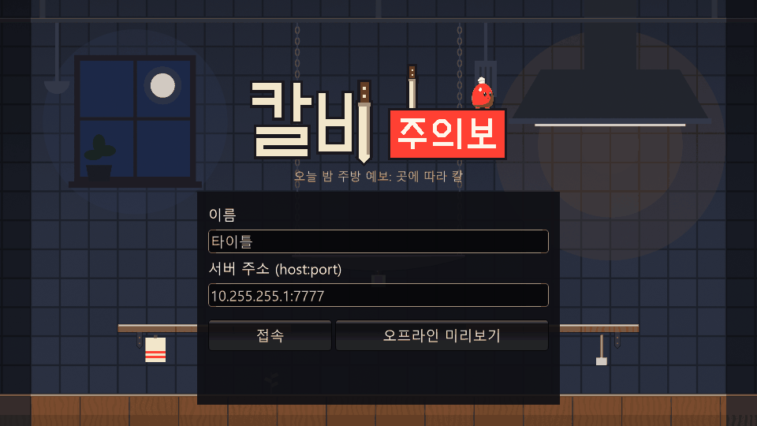
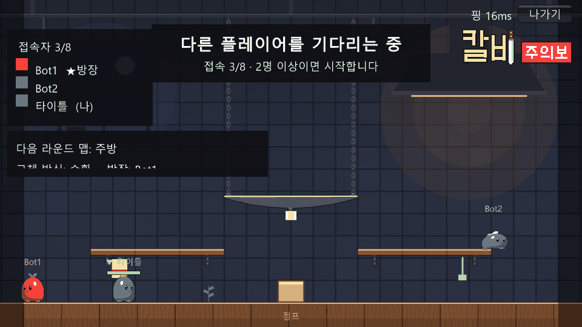
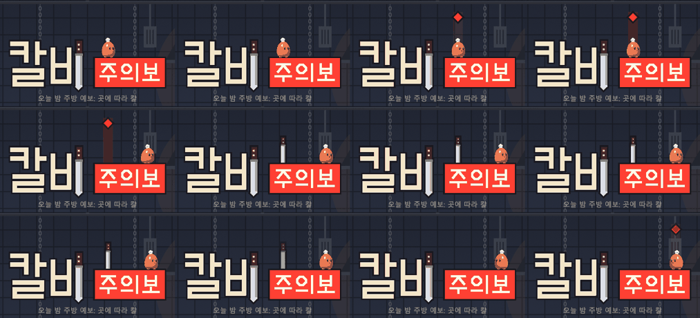

# 타이틀(게임 이름·로고)

담당 세션: `[OnlineSeverGame] 타이틀 · 01`
범위: 게임 이름을 정하고, 로고를 그림 파일 없이 코드로 그려 Unity 클라이언트 접속 화면과 대기 화면에 넣는다.

## 1. 어떻게 보이는가

게임 이름은 **칼비 주의보**다. "칼 + 비"에 기상 특보 "호우주의보"를 붙인 말장난으로, 위에서 칼이 비처럼 떨어지고 떨어지기 전에 빨간 예고가 뜨는 이 게임의 규칙을 그대로 옮겼다. 그 아래에는 일기예보 투의 한 줄 "오늘 밤 주방 예보: 곳에 따라 칼"을 작은 글씨로 넣었다.



- **접속 화면·접속 중 화면**: 가운데 위쪽에 큰 로고와 한 줄 소개가 있고, 그 아래에 이름·서버 주소 입력 패널(또는 "접속 중…" 패널)이 있다. 예전 패널 안의 "OnlineSeverGame" 글자는 뺐다.
  - 로고는 움직인다. 빨간 "주의보" 팻말 위에 귤 젤리(요리사 모자)가 서 있다. 젤리 머리 위로 게임과 똑같은 빨간 예고(반투명 기둥 + 깜빡이는 마름모)가 뜨고 점점 빨리 깜빡인다. 젤리가 팻말 반대쪽으로 달려 비키면 칼이 떨어져 팻말에 꽂히고, 2초쯤 뒤 흐려지며 사라진다. 4초마다 좌우를 바꿔 되풀이한다.
  - 로고 크기는 창 크기를 따른다(960×540에서 폭 약 330 px, 1600×900에서 약 560 px). 접속 중 화면으로 넘어가도 로고 위치와 크기는 그대로다.
- **대기·카운트다운 화면**: 오른쪽 위 "나가기" 버튼 바로 아래에 움직이지 않는 작은 로고(폭 약 190 px)가 있다. 대기 중에도 캐릭터를 움직일 수 있어서, 게임 예고와 헷갈릴 만한 깜빡임과 낙하는 뺐다.
- 게임 진행·관전·결과 화면에는 로고가 없다(화면을 가리지 않으려고).



움직이는 로고를 0.45초 간격으로 찍은 12장(왼쪽 위부터 차례로):



### 생김새를 이렇게 정한 이유

이미지 생성 AI가 흔히 만드는 매끈한 그라데이션, 번들거리는 광택, 뜻 없는 반짝이·소용돌이 장식을 피하고, 이 게임에서 이미 쓰는 그림 말투를 따랐다.

- **사각형만 쓴다.** 클라이언트는 원래 흰 사각형에 색을 입혀 그렸고(`View/Shapes.cs`), 지금도 예고 기둥·마름모(`View/SwordView.cs`)가 그렇게 그려진다. 로고 글자도 획 두께 2인 격자 위에 사각형을 하나하나 손으로 놓아 만들었다. 비스듬한 획(ㅈ의 두 다리)과 ㅇ(팔각형 여덟 변)만 돌린 사각형이다.
- **색은 평평하게, 외곽선은 굵게.** 모든 조각 밑에 어두운 외곽선(#1A181E)을 깔고 그 위에 단색을 칠한다. 큰 글자는 선반 윗면 밝은 선과 비슷한 크림색(#F3E6C8), 팻말은 게임 예고와 같은 빨강(#FF4033)이다. 그라데이션이나 하이라이트는 하나도 없다.
- **장식마다 뜻이 있다.** "비"의 ㅣ 는 꽂힌 식칼(손잡이·리벳 둘·받침쇠·칼날·칼등·칼끝)이고, 마름모와 기둥은 게임 안 예고 표시 그대로이며, 젤리는 게임 캐릭터 스프라이트(`ArtSprites.Character`) 그대로다. 로고만 보고도 "위를 보고 피하는 게임"이라는 것을 알 수 있게 했다.
- **실제 게임 장면을 재현한다.** 예고 깜빡임은 `SwordView`와 같은 식(`PingPong(time × lerp(2, 10, 진행))`, 낙하가 가까울수록 빠르고 진하게)이고, 예고가 뜬 뒤 조금 늦게 젤리가 비키고 그 뒤에 칼이 떨어지는 순서도 게임과 같다.

## 2. 어떻게 구현했는가

| 파일 | 내용 |
|---|---|
| `Client/Assets/Scripts/UI/TitleLogo.cs` | 로고 조각 만들기(글자별 함수 `Kal`·`Bi`·`Ju`·`Ui`·`Bo`, 칼 `Knife`), IMGUI 그리기, 움직임 계산 |
| `Client/Assets/Scripts/UI/GameUI.cs` | `TitleAndPanel`: 접속·접속 중 화면에서 로고 + 한 줄 소개 + 패널 배치. `DrawLobby` 끝에서 작은 로고 |

- **로고 단위.** 좌표는 "로고 단위"(아래로 +y)로 적고, 그릴 때 `ppu`(로고 단위 1 = 픽셀 몇 개)를 곱한다. 큰 글자 한 자는 16 × 20 격자, 팻말 글자는 14 × 15 격자를 0.56배로 줄여 쓴다. 로고 전체는 약 70 × 24 단위다.
- **조각 목록.** 정적 생성자에서 `Pen`(원점·배율·색을 가진 붓)으로 사각형 `Part`(왼쪽 위, 크기, 가운데 기준 회전 각, 색) 목록을 한 번 만든다. 글자 모양을 고치려면 해당 글자 함수의 `p.R(x, y, w, h)` 숫자만 바꾸면 된다. 각 줄 끝 주석에 어느 자모인지 적어 두었다.
- **그리기.** IMGUI(`OnGUI`)에서 `GUI.DrawTexture(Texture2D.whiteTexture)`에 `GUI.color`를 입혀 그린다. 돌린 조각은 `GUIUtility.RotateAroundPivot`으로 행렬을 돌렸다가 되돌린다. 먼저 모든 조각을 0.7 단위씩 키워 어두운 색으로 칠해 외곽선을 만들고, 그다음 제 색으로 칠한다. Repaint 이벤트에서만 그린다.
- **IMGUI를 쓴 이유.** 접속 화면 UI가 이미 IMGUI이고, 로고가 입력 패널 위치와 함께 움직여야 해서 같은 좌표계에 두는 편이 단순하다. 월드 스프라이트로 그리면 카메라 크기(스테이지 맞춤)에 끌려간다. 그림 파일을 따로 만들지 않아서 창 크기가 바뀌어도 흐려지지 않는다.
- **움직임(`Animate`).** 8초 주기를 4초씩 둘로 나눠 좌우를 바꾼다. 반 주기 안에서 0.3~1.5초 예고, 0.9~1.4초 젤리가 반대쪽 자리로 달려감(`run` 동작, 그 밖에는 `idle`), 1.5~1.7초 칼 낙하(가속), 1.7~3.4초 꽂혀 있음, 3.4~3.8초 흐려짐. 떨어지는 칼은 "비"의 칼과 같은 조각을 0.6배로 줄여 쓴다. 팻말보다 먼저 그려서 팻말 외곽선이 칼을 가로지르게 했다(꽂혀 보이도록).
- **젤리 그리기.** 스프라이트의 `textureRect`를 UV로 바꿔 `GUI.DrawTextureWithTexCoords`로 그리고, 왼쪽을 볼 때는 `GUIUtility.ScaleAroundPivot(-1, 1)`로 뒤집는다. 프레임 피벗(발밑 8 px)을 팻말 윗변 외곽선 위에 맞춘다.
- **배치.** 로고 크기는 `min(창 폭/130, (창 높이 − 접속 패널 270 − 70)/43)`을 2.5~8 사이로 자른 값이다. 접속 패널 높이(270, 접속 실패 문구 두 줄까지 들어감)로만 계산하므로 접속 중 화면(패널 120)으로 넘어가도 로고가 그대로 있다. 로고 + 한 줄 소개 + 패널을 세로 가운데에 놓는다.
- **창 제목·실행 파일 이름은 그대로 뒀다.** `PlayerSettings.productName`("OnlineSeverGame")을 바꾸면 창 제목은 바뀌지만, Unity가 저장값(PlayerPrefs: 이름, 서버 주소) 위치를 제품 이름으로 정해서 기존 저장값이 사라진다. 바꿀지는 따로 정할 일로 남긴다.

## 3. 직접 돌려 보기

빌드(저장소 루트):

```bash
"C:/Program Files/Unity/Hub/Editor/6000.6.3f1/Editor/Unity.exe" -batchmode -nographics -projectPath Client -executeMethod OnlineSeverGame.Client.EditorTools.ProjectSetup.BuildWindows -quit -logFile build.log
```

접속 화면 로고(서버 없이). 3초부터 0.45초마다 찍어 움직임을 본다:

```bash
Client/Build/Windows/Client.exe -screenshot shot{n}.png -screenshotDelay 3 -screenshotEvery 0.45 -quitAfter 8
```

대기 화면 작은 로고(서버 + 봇 2개, 최소 4명이라 대기가 이어진다):

```bash
dotnet run --project Server/GameServer -- --port 7790 --min-players 4
```

```bash
dotnet run --project Tools/BotClient -- --port 7790 --count 2 --duration 30
```

```bash
Client/Build/Windows/Client.exe -server 127.0.0.1:7790 -autoconnect -screenshot lobby{n}.png -screenshotDelay 4 -screenshotEvery 2 -quitAfter 9
```

큰 창에서 보려면 `-screen-width 1600 -screen-height 900`을 붙인다. Unity는 이 창 크기를 기억하므로 다음 실행에서 `-screen-width 960 -screen-height 540`으로 되돌린다.

## 4. 확인한 것과 남은 일

확인함(2026-11-03, Windows 빌드):
- 배치 모드 빌드 3번 모두 성공, 컴파일 경고·오류 없음.
- 접속 화면(960×540): 로고·한 줄 소개·입력 패널이 겹치지 않음. 0.45초 간격 12장에서 예고 → 젤리 비킴 → 칼 낙하·꽂힘 → 흐려짐 → 반대쪽 예고 순서가 보임(위 그림).
- 접속 화면(1600×900): 로고가 커지고(ppu 8), 접속 실패 문구 "서버가 응답하지 않습니다 (연결 거부)"가 패널 안에 들어감. 처음에는 패널(236)이 낮아 문구가 잘려서 270으로 늘렸다.
- 접속 중 화면(응답 없는 주소 `10.255.255.1`): 로고가 접속 화면과 같은 자리에 있고 그 아래 "접속 중…" 패널.
- 대기 화면(서버 + 봇 2개): 오른쪽 위 작은 로고가 핑·나가기 버튼, 가운데 안내 띠와 겹치지 않음. 글자가 읽힘.
- 실행 로그에 예외 없음.

확인 못 함 / 남은 일:
- 에디터 플레이 모드, 960×540보다 작은 창(로고는 ppu 2.5까지 줄지만 패널과 겹칠 수 있음), 고해상도 배율(DPI) 설정.
- 사람 눈으로 본 평가(이름·한 줄 소개가 마음에 드는지)는 사용자 몫이다.
- 창 제목·실행 파일 이름은 아직 "OnlineSeverGame" / `Client.exe`(2장 마지막 항목).
- 작업과 무관하게 본 것: 대기 화면에서 방장이 아닌 사람의 맵 패널(높이 76)에 두 번째 줄 "교체 방식 …"이 반쯤 잘린다(대기 화면 그림 왼쪽 가운데). 이 작업 전부터 있던 문제라 고치지 않았다.

## 5. 변경 기록

| 날짜 | 커밋 | 내용 |
|---|---|---|
| 2026-11-03 | (이 커밋) | 이름 "칼비 주의보" 결정, 사각형으로 그린 로고(`TitleLogo.cs`), 접속·접속 중 화면 움직이는 로고와 한 줄 소개, 대기 화면 작은 로고, 스크린샷 3장 |
