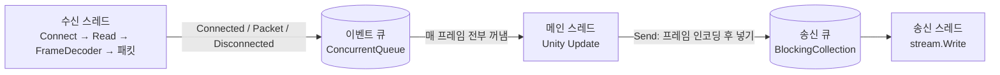

# 작업 기록: Unity 클라이언트

- 담당 세션: `[OnlineSeverGame] Unity 클라이언트 · 01`
- 상태: 핵심 완료. 서버·봇과 접속해 라운드를 끝까지 진행하는 것까지 확인. 다듬기(에디터 플레이 확인, 손 조작감, 그래픽) 남음.
- 관련 커밋: `cf08e10` (프로젝트·임시 그래픽·화면 골격), `a8cf1dc` (네트워크·예측·보간)
- 프로젝트 위치: `Client/` (Unity 6000.6.3f1, 2D, Built-in 렌더러, 구 Input Manager)
- 공용 규칙(패킷·상수·예측 규칙): [`docs/protocol.md`](../protocol.md)

이 문서는 클라이언트가 "화면에서 어떻게 보이고, 안에서 어떻게 돌아가는지"를 사람이 읽기 위한 기록이다. 작업할 때마다 맨 아래 **변경 기록**에 한 줄씩 추가한다.

---

## 1. 어떻게 플레이되는가

### 화면 흐름

1. **접속 화면**: 이름과 서버 주소(`host:port`, 기본 `127.0.0.1:7777`)를 넣고 **접속**(또는 Enter). 서버 없이 화면만 보려면 **오프라인 미리보기**.
2. **접속 중**: 5초 안에 연결이 안 되면 이유(연결 거부, 시간 초과, 주소 오류, 방 가득 참, 버전 불일치)를 접속 화면에 띄우고 돌아간다.
3. **대기**: 위쪽에 "다른 플레이어를 기다리는 중", 왼쪽에 접속자 목록(색·이름, 내 이름 옆 "(나)"). 이때도 자유롭게 뛰어다닐 수 있다.
4. **카운트다운(3초)**: "n초 후 라운드 시작". 서버가 스폰 지점으로 옮기면 내 캐릭터도 미끄러지지 않고 바로 옮겨진다.
5. **진행**: 왼쪽 위에 생존 수·경과 시간, 오른쪽 위에 라운드 번호·핑·나가기, 아래에 조작 안내.
6. **관전**: 칼에 맞으면 "탈락! 관전 중 / 남은 생존자 n명". 라운드 도중 들어오면 "관전 중 / 다음 라운드부터 참가합니다". 스테이지 전체가 늘 한 화면에 보이므로 관전 시점 전환은 없다.
7. **결과(5초)**: "승리!" / "공동 승리!" / "승자: 이름" / "승자 없음", 순위표(1위부터, 같은 순간 죽은 사람은 같은 순위), 생존 시간 또는 "생존"·"끊김", "n초 후 다음 라운드". 서버가 알아서 다음 라운드로 넘어간다.
8. 서버가 꺼지거나 연결이 끊기면 "서버가 연결을 끊었습니다" 등의 이유와 함께 접속 화면으로 돌아간다.

### 조작

| 키 | 동작 |
|---|---|
| ← → / A D | 좌우 이동 |
| ↑ / W / Space | 점프 |
| Shift / J | 대시 (부딪힌 상대를 밀침) |
| ↓ / S | 누르고 있으면 발판 아래로 통과 |

틱(50ms) 사이에 짧게 톡 누른 점프·대시도 놓치지 않는다.

### 화면에 보이는 것 (임시 단색 도형)

- **플레이어**: 0.8×1.2 사각형, 접속 번호마다 8색(빨강·파랑·초록·노랑·보라·주황·하늘·분홍). 검은 눈이 바라보는 쪽을 알려 준다. 내 캐릭터는 흰 테두리와 이름 앞 ▼. 대시 중에는 뒤쪽에 반투명 잔상. 죽은 사람과 관전자는 회색으로 흐리게 남는다.
- **칼**: 칼날·가드·손잡이로 된 1.0 높이 칼. 칼끝이 아래.
- **낙하 예고**: 칼이 떨어질 x에 붉은 기둥. 기둥은 **칼이 꽂힐 면(발판 또는 바닥)부터** 화면 위까지라서, 발판 아래가 안전한지 바로 보인다. 꽂힐 자리에 붉은 줄, 화면 위에 붉은 마름모. 낙하가 가까워질수록 빨리, 진하게 깜빡인다.
- **스테이지**: 서버와 같은 `Stage.Default`(바닥 + 낮은 발판 2개 + 가운데 높은 발판). 양옆 벽은 짙은 색 띠.

---

## 2. 어떻게 구현했는가

### 파일 구성 (`Client/Assets/`)

```
Scenes/Main.unity          Main Camera + Game(GameBootstrap) 두 개뿐
Editor/ProjectSetup.cs     씬·빌드 설정 만들기, Windows 빌드 (배치 모드용)
Scripts/
  Game/GameBootstrap.cs    시작점. 카메라·스테이지·뷰·UI를 코드로 만들고 세션을 바꿔 끼움
  Game/NetworkSession.cs   서버 접속 세션: 입력 전송, 예측·보정, 보간, 화면 상태
  Game/PreviewSession.cs   서버 없이 보는 오프라인 미리보기
  Net/NetClient.cs         TCP 연결과 수신·송신 스레드
  Input/InputCollector.cs  키 입력 모으기(틱 단위로 꺼냄), 시험용 자동 입력
  Model/                   그리기용 상태(WorldRender), 화면 상태(SessionState), 스테이지 변환(StageLayout)
  View/                    사각형 그리기(Shapes), 스테이지·플레이어·칼 뷰
  UI/GameUI.cs             IMGUI 화면 전부
```

씬에 오브젝트를 배치하지 않고 코드로 만든 이유: 에디터를 열지 않고 텍스트만으로 고치고 배치 모드로 빌드·확인할 수 있게 하려고. 그래픽이 단색 도형이라 손해가 거의 없다.

### Shared 사용

`Client/Packages/manifest.json`에 `"com.onlinesevergame.shared": "file:../../Shared"`를 넣어 서버와 **같은 소스**를 쓴다. 클라이언트가 직접 쓰는 것:

- `FrameDecoder`, `PacketCodec`, 패킷 클래스들: 프레임 조립·패킷 읽기/쓰기
- `PlayerPhysics.Step`, `PlayerState`, `InputButtons`: 내 캐릭터 예측
- `Stage.Default`, `Stage.KnifeLandingY`, `GameConstants`: 스테이지 모양, 칼 꽂힐 높이, 크기·틱 상수

좌표는 정수 밀리유닛 그대로 들고 있다가 그릴 때만 `/1000f` 한다.

### 스레드 구성 (`NetClient`)



- **수신 스레드**: 연결(5초 제한)부터 맡는다. 연결되면 송신 스레드를 띄우고, 블로킹 `Read` → `FrameDecoder.Push` → `TryReadFrame`이 false가 될 때까지 `DecodePayload` → 이벤트 큐. 읽기가 0바이트면 "서버가 연결을 끊었습니다".
- **송신 스레드**: 메인 스레드가 소켓 쓰기에 막히지 않게 따로 둔다. 큐가 256개를 넘으면 서버가 안 읽는 것으로 보고 끊는다.
- **메인 스레드**: Unity API는 메인 스레드에서만 되므로, 패킷 처리·물리 예측·그리기는 전부 여기서 한다. 다른 스레드는 바이트와 패킷만 다룬다.
- 끊김 이벤트는 한 번만 나가게 락으로 막는다. 사용자가 "나가기"로 닫을 때는 끊김 메시지를 띄우지 않는다.
- 연결 후 5초 동안 서버에서 아무 패킷도 안 오면(스냅샷은 초당 20개 와야 함) 끊김으로 처리한다.

### 입력 보내기

- 클라이언트도 **고정 20Hz 틱**을 돈다(`Time.deltaTime`을 모아 50ms마다). 프레임이 크게 밀려도 한 번에 5틱까지만 따라잡는다.
- 틱마다: 키 상태 → `InputButtons` → seq 1 증가 → `Input(seq, buttons)` 전송 → 미확인 목록에 저장 → (살아 있으면) 바로 예측 스텝.
- 점프·대시는 서버가 "이전 틱엔 안 눌림 → 이번 틱 눌림"으로 판정한다. 틱 사이에 눌렀다 뗀 것도 그 틱에는 켜서 보내야 하므로 `InputCollector`가 눌린 순간을 다음 틱까지 기억한다.
- 1초마다 Ping을 보내 핑(왕복 시간)을 표시한다.

### 내 캐릭터: 예측과 보정

내 입력을 서버 왕복(로컬에서도 약 50~100ms)만큼 기다렸다 움직이면 굼뜨게 느껴진다. 그래서:

1. **예측**: 입력을 보내는 즉시 `PlayerPhysics.Step`으로 내 캐릭터를 움직인다. 서버와 같은 정수 코드라 보통은 서버 결과와 완전히 같다.
2. **보정**: 스냅샷이 오면 내 항목의 상태로 되돌리고, 서버가 아직 처리하지 않은 입력(`seq > lastInputSeq`)만 순서대로 다시 계산한다.
3. **튀지 않게**: 보정 전후 화면 위치 차이를 "보정 오프셋"으로 들고 있다가 초당 15배 속도로 0으로 줄인다. 2.5유닛 넘게 어긋나거나 새 라운드 시작(`RoundStart`, 스폰 순간이동)이면 부드럽게 하지 않고 바로 옮긴다.
4. 틱 사이(60fps 화면에서 50ms 틱)는 직전 예측과 현재 예측 사이를 보간해 매끄럽게 그린다.
5. 죽었거나 관전자면 예측을 멈추고 스냅샷대로 그린다.

밀치기는 서버만 판정하므로(클라이언트가 예측하지 않음) **밀릴 때만** 보정이 생긴다. 실제 시험에서도 그랬다(아래 4장).

### 다른 플레이어와 칼: 보간

- 스냅샷을 최근 32개 보관한다. 마지막 스냅샷 틱과 받은 시각으로 "지금 서버 틱"을 추정하고, 그보다 **2틱(100ms) 과거**를 그린다. 그 시점을 사이에 둔 스냅샷 두 개의 위치를 선형 보간한다. 앞으로 내다보는 추측(외삽)은 하지 않는다.
- 추정 시계는 프레임마다 조금씩 목표로 당겨 맞추고, 4틱 넘게 벗어나면 바로 맞춘다.
- 칼: 예고 중엔 x만 쓰고 남은 시간으로 깜빡임 속도를 정한다. 떨어지는 중엔 y를 보간한다. 예고 → 낙하 경계에서는 칼이 출발 높이에서 바로 보이게 한다.
- 입장·퇴장은 최신 스냅샷 기준이라 바로 반영된다.

### 화면 상태 정하기

서버 스냅샷의 `roomState`가 기준이다. Waiting → 대기, Countdown → 카운트다운(남은 틱 → 초), Playing → 내가 살아 있는 참가자면 진행 아니면 관전, Ended → 결과(`RoundEnd` 순위·승자·사유). 접속자 명단은 `PlayerJoined/Left`로, 생존·참가 여부는 스냅샷으로 채운다. 라운드 중 나간 사람 이름은 결과 화면에 남겨 둔다. 카운트다운 중 누가 들어와 같은 번호의 `RoundStart`가 다시 오면 참가자 목록만 갱신한다(순간이동 처리는 그 라운드 첫 `RoundStart` 때만).

### 오프라인 미리보기

서버 없이 그래픽·화면 흐름·입력을 보려고 만든 가짜 세션. 봇 7개가 무작위로 움직이고 칼이 떨어지며 대기 → 진행 → 관전 → 결과가 돈다. 물리는 대충 흉내만 낸 것이라 실제 게임 감각과 다르다.

---

## 3. 직접 돌려 보기

### 서버와 함께 (저장소 루트에서)

```bash
dotnet run --project Server/GameServer -- --port 7777 --min-players 2
```

```bash
dotnet run --project Tools/BotClient -- --count 7
```

그다음 클라이언트를 켜고 `127.0.0.1:7777`로 접속한다(클라이언트 1 + 봇 7 = 8명).

### 클라이언트 켜는 방법

- **에디터**: Unity Hub에서 `Client/` 열기 → `Assets/Scenes/Main.unity` → Play.
- **빌드**: 메뉴 `OnlineSeverGame > Build Windows` 또는 배치 모드:

```bash
"C:/Program Files/Unity/Hub/Editor/6000.6.3f1/Editor/Unity.exe" -batchmode -nographics -projectPath Client -executeMethod OnlineSeverGame.Client.EditorTools.ProjectSetup.BuildWindows -quit -logFile build.log
```

  결과는 `Client/Build/Windows/Client.exe` (Git 제외).

- 두 명이 서로 보이는지 보려면 빌드를 두 번 실행한다(창이 비활성이어도 계속 돈다).

### 시험용 명령줄 인자 (빌드 실행 시)

| 인자 | 뜻 |
|---|---|
| `-name 이름` / `-server host:port` | 접속 정보 미리 채우기 |
| `-autoconnect` | 켜자마자 접속 |
| `-preview` | 오프라인 미리보기로 시작 |
| `-autoplay` | 무작위로 움직이고 점프·대시 |
| `-autoplay chase` | 가장 가까운 상대에게 다가가 가까우면 대시(밀치기 시험) |
| `-screenshot 경로{n}.png -screenshotDelay 초 -screenshotEvery 초` | 스크린샷 자동 저장 |
| `-quitAfter 초` | 시간이 되면 종료 |
| `-logFile 경로` | Unity 로그 저장 |

예: 서버를 띄운 뒤 창 두 개로 밀치기 시험

```bash
Client/Build/Windows/Client.exe -name 표적 -server 127.0.0.1:7777 -autoconnect -autoplay
```

```bash
Client/Build/Windows/Client.exe -name 공격 -server 127.0.0.1:7777 -autoconnect -autoplay chase
```

### 로그에서 볼 것

- `[Client] screen Playing round=2 alive=6/6`: 화면 전환
- `[Net] stats ... pending=2 ping=17ms reconciles=303 mispredicts=1 maxCorrection=0.408`: 5초마다. `pending`은 서버가 아직 처리 안 한 내 입력 수(로컬이면 1~3), `mispredicts`는 예측이 0.01유닛 넘게 빗나간 횟수(밀릴 때만 늘어야 정상).
- `[Net] round 2 end, winners=[Bot4] ...`

---

## 4. 확인한 것과 남은 일

확인함 (2026-10-27, 모두 Windows 빌드 + 자동 입력):

- 배치 모드 컴파일·빌드 경고·오류 없음.
- **서버 + 봇 5개 + 클라이언트, 2판**: 1판 도중 입장 → "관전 중", 1판 결과, 2판 카운트다운·진행·밀치기(서버 로그 `push #6 -> #3` 등)·칼에 사망·관전·결과, 서버 종료 시 "서버가 연결을 끊었습니다" 후 접속 화면. 예외 없음. 핑 17ms(같은 PC).
- **예측**: 걷기·점프·대시만 하는 동안 빗나감 0회. 빗나감은 밀렸을 때만 생겼고 최대 0.38~1.6유닛, 화면에서는 부드럽게 따라붙음.
- **클라이언트 2개(빌드 둘)**: 서로 보임. `chase` 쪽이 상대를 여러 번 밀침(서버 로그 `push #2 -> #1` 12회, 밀린 쪽 보정 12회). 같은 칼에 둘이 동시에 죽어 "공동 승리!" 둘 다 1위로 표시.
- **8인 방(봇 7 + 클라이언트)**: 한 판 끝까지, 클라이언트 3위.
- 결과 화면: 살아남은 승자는 "생존", 동시에 죽은 공동 승자·나머지는 생존 시간.
- 서버가 없을 때 "서버가 응답하지 않습니다 (연결 거부)".
- 카운트다운 중 봇 3개 입장: 같은 번호 `RoundStart`가 3번 더 와서 참가자 2 → 5명으로 갱신, 순간이동 처리는 처음 한 번만, 5명으로 판 진행.

아직 확인 안 함:

- **에디터 플레이 모드**(빌드 두 개로만 시험). 에디터 + 빌드 조합.
- **사람이 키보드로 직접 하는 조작감**(자동 입력으로만 시험).
- 다른 PC 간 접속, 실제 네트워크 지연·손실 상황, 장시간 실행.

남은 일 / 다듬을 후보:

- 클라이언트 틱과 서버 틱의 시계 차이 보정 없음(각자 20Hz). 오래 하면 서버 입력 큐가 비거나 넘칠 수 있으나 서버가 흡수하고 스냅샷으로 맞춰진다. 필요하면 `pending` 수를 보고 틱 속도를 미세 조정.
- 결과 화면 동안에도 입력을 보내는데 서버가 처리하지 않아 `pending`이 늘어난다(64개에서 자름, 다음 판 보정으로 해결, 문제 없음).
- 그래픽은 단색 도형, 소리·효과 없음, UI는 IMGUI 고정 크기(해상도 배율 없음).
- 시험 중 클라이언트 창이 예정보다 일찍 닫힌 일 1번, 끊긴 뒤 다시 접속 시도 1번(창 클릭·Enter로 추정, 재현 안 됨).

---

## 변경 기록

- 2026-10-27 `cf08e10` Unity 프로젝트 생성, 코드로 만드는 씬, 임시 그래픽(스테이지·플레이어 8색·칼·낙하 예고), IMGUI 화면 골격, 입력 수집, 오프라인 미리보기.
- 2026-10-27 `a8cf1dc` Shared 참조, TCP 수신·송신 스레드, 입력 전송, 내 캐릭터 예측·보정, 다른 플레이어·칼 보간, 라운드 화면을 서버 상태에 연결, 연결 끊김 처리. 서버 + 봇과 여러 판 확인.
- 2026-10-27 이 문서 작성(작업 문서 규칙). 같은 번호 `RoundStart`는 참가자 갱신으로만 처리(프로토콜 문서 변경 반영).
